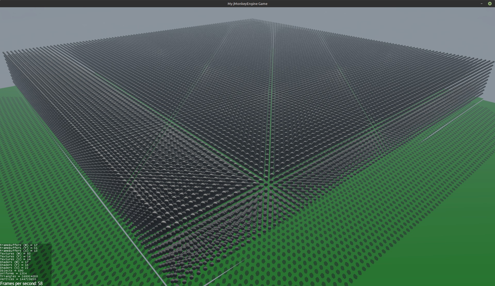
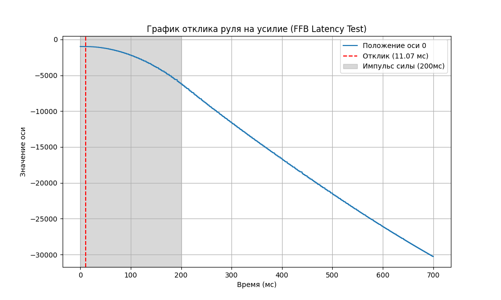
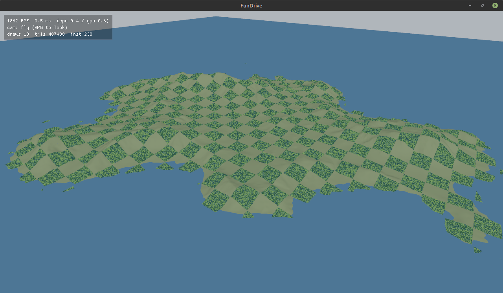
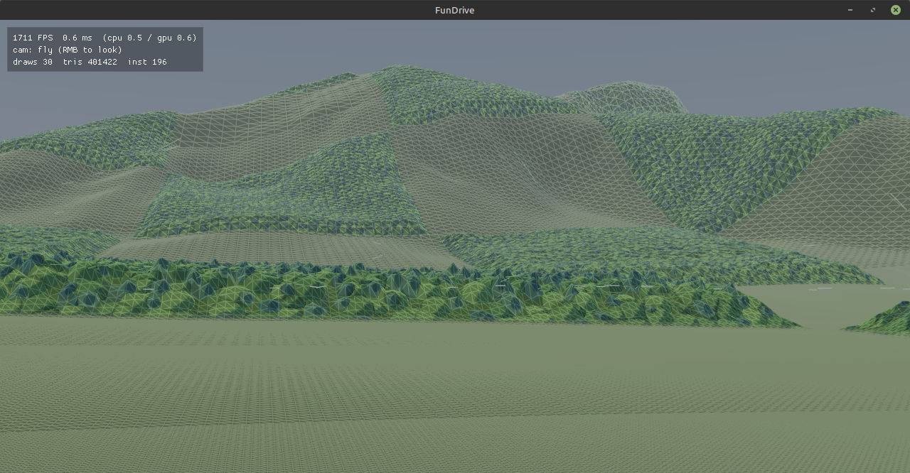
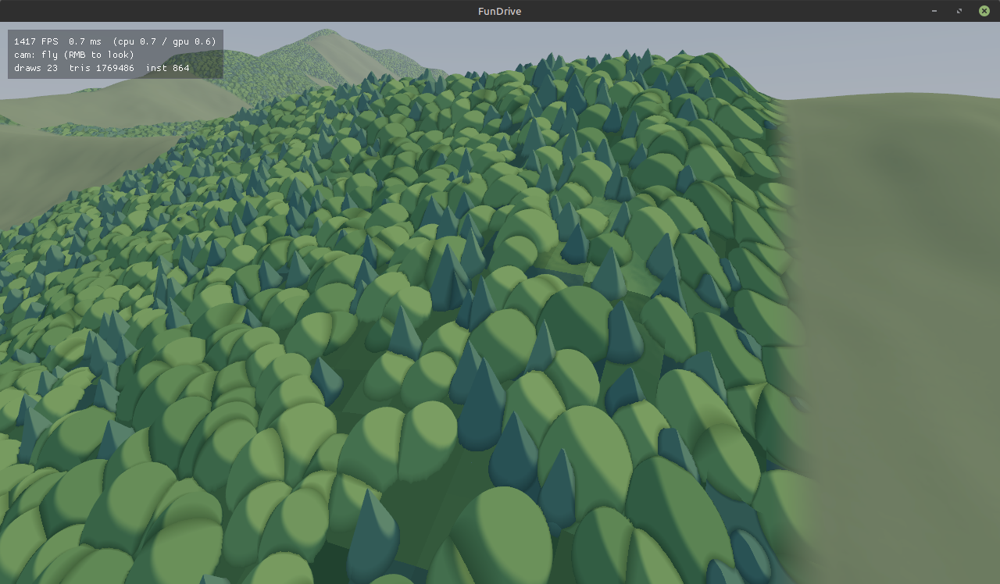
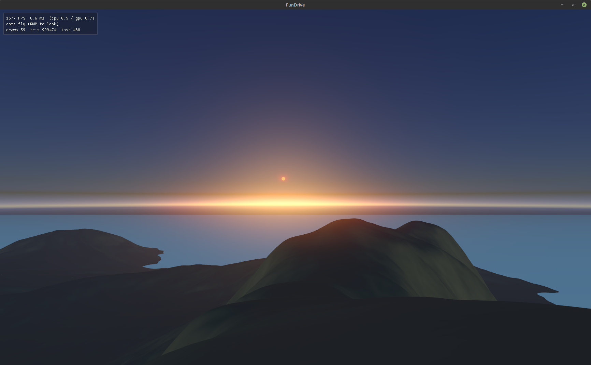
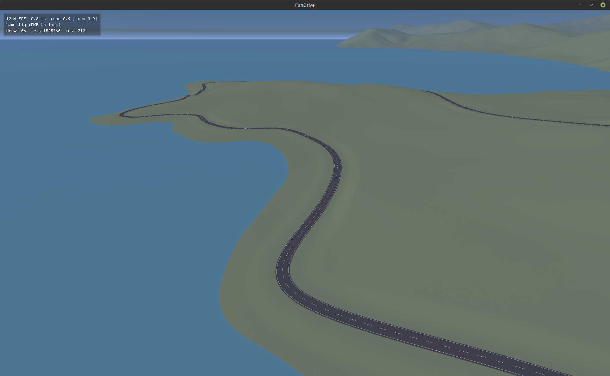
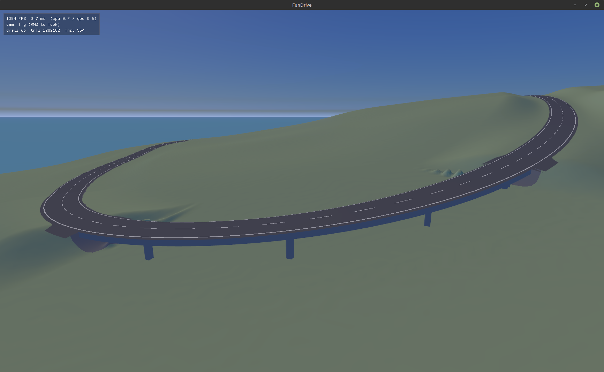
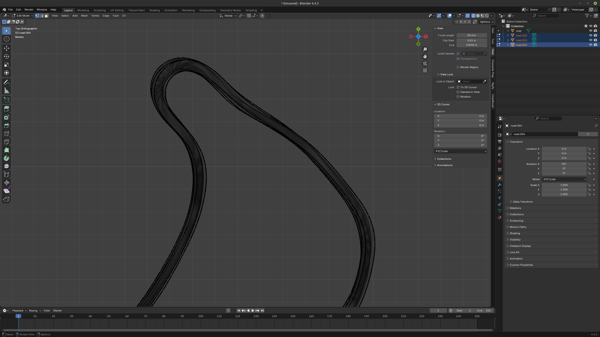

# 2026-05-21

Я попытался перетащить игру на Unreal Engine 5. Процесс мне не понравился, на плюсах сильно медленнее писать и отлаживать код. А ещё, кстати, скорость работы физики на С++ по сравнению с JVM отличалась всего лишь в два раза.

И я вдруг пришёл к мысли, что в моей игре графика - это совсем не главное, и куда важнее удобство и скорость разработки. И производительность физики проблемой не является - её хватает с хорошим запасом.

Но libgdx мне не нравится, и я попробовал сделать прототип на jMonkeyEngine. Результат меня приятно удивил - есть много чего стандартного и нормально работающего из коробки.


## Графический движок

Я немного покумекал с нейронкой про возможности движка и пришёл к такой архитектуре:

Использую forward рендер, потому что он простой и хорошо сочетается с честным сглаживанием типа MSAA x4. Не будет ужасных лесенок по краям объектов.
Будут тени от солнца (jME поддерживает каскадные карты теней из коробки и они выглядят нормально)
Для повторяющихся объектов типа деревьев буду использовать инстансинг.
Для борьбы с overdraw использовать early-Z проход, чтобы сначала отрендерить карту глубины и пиксельный шейдер вызывать только для видимых пикселей.
Про материалы ещё не решил - либо PBR, либо что-то более простое.


### Какие ограничения нашёл:

Лайтпробы генерируются реально медленно, кажется что проще вообще забить на динамическое обновление. Причём всякие каустики считаются на CPU. Можно отказаться от каустик, но всё равно даже просто рендеринг в текстуру - это рендеринг в шесть камер и он медленный.

Стандартного эффекта для SSR как будто нет, а тот что есть - не очень поддерживает MSAA. Он мог бы использоваться для красивых зеркальных отражений, но он не очень красиво выглядит по краям экрана. Я в будущем планирую поддерживать трипл скрин (с тремя камерами), и как будто на границе между мониторами SSR будет рисовать фигню и бросаться в глаза.

Ради интереса я попробовал отрендерить сто тысяч шаров при помощи мульти инстансинга с тенями. Получается 270 миллионов полигонов и 140 миллионов вершин. Не то чтобы я собирался так делать в игре, просто померял для понимания предела возможностей. Видеокарта geforce 4080 почти справляется на 58 кадров в секунду.


Так что мой предварительный план такой - сделать рендер, чтобы мог рисовать большую карту с большим количеством объектов, и чтобы были тени от всяких домов, деревьев и гор.




# 2026-05-29

## Как избежать пауз GC.

В JVM по умолчанию стоит G1GC и максимальное время паузы 200 мс. Реально я у себя видел около 20 мс. По понятным причинам для игры в 60 или 120 фпс он не подходит.

В более новых jvm для реалтайм задач появился ZGC (Z Garbage Collector), который собирает мусор в отдельных потоках. Там есть пауза, когда он реально приостанавливает все потоки, но она буквально занимает десяток микросекунд. 
При этом фоновая сборка мусора на моём примере идёт примерно те же 20 мс, как и на G1GC, но она не останавливает игровой поток.
В java 21 сборщик улучшили и он стал Generational ZGC (причём он настолько лучше, что с java 24 старого ZGC больше нет).

Из минусов - если новые потоки будут выделять память быстрее, чем будут справляться фоновые потоки GC, то память закончится и будет фиаско.

Запустить с профайлером можно примерно так:

```bash
java -XX:+UseZGC \
     -XX:+UnlockDiagnosticVMOptions \
     -XX:+DebugNonSafepoints \
     -XX:StartFlightRecording=delay=10s,duration=60s,filename=game_profile.jfr,settings=profile,jdk.ExecutionSample#period=5ms \
     -jar your-game.jar
```
Профайлер запустится через 10 секунд после старта на минуту и запишет результаты в файл.
В нём можно посмотреть паузы на сборку мусора и прочую инфу.


# 2026-06-02

Выяснил, что устройства от Moza могут присылать ивенты с обновлениями почти тысячу раз в секунду.

Как проверил - навайбкодил на питоне скрипт, который через SDL получает список устройств и считает ивенты за секунду.
От педалей даже больше тысячи, но кажется что просто они в одном пакете кидают несколько педалей, и SDL интерпретирует их как отдельные ивенты.


Код тут: [https://github.com/Kright/mySmallProjects/blob/master/2026/pySDL/main.py](https://github.com/Kright/mySmallProjects/blob/master/2026/pySDL/main.py)

Ещё можно посмотреть данные о USB и узнать, что это всё подключается как usb 2.0, но со скоростью usb 1.1 (12 мбит). Частота опроса - 1 миллисекунда, так что больше тысячи ивентов в секунду не получить, и получается что девайс работает как раз около этого лимита.

```
usb-devices
```

```
Bus=05 Lev=03 Prnt=17 Port=01 Cnt=01 Dev#= 18 Spd=12   MxCh= 0
D:  Ver= 2.00 Cls=ef(misc ) Sub=02 Prot=01 MxPS=64 #Cfgs=  1
P:  Vendor=346e ProdID=0001 Rev=01.00
S:  Manufacturer=Gudsen
S:  Product=MOZA CRP2 pedals
S:  SerialNumber=36001F000B57484838303120
C:  #Ifs= 3 Cfg#= 1 Atr=c0 MxPwr=100mA
I:  If#= 0 Alt= 0 #EPs= 1 Cls=02(commc) Sub=02 Prot=00 Driver=cdc_acm
E:  Ad=81(I) Atr=03(Int.) MxPS=   8 Ivl=1ms
I:  If#= 1 Alt= 0 #EPs= 2 Cls=0a(data ) Sub=00 Prot=00 Driver=cdc_acm
E:  Ad=02(O) Atr=02(Bulk) MxPS=  64 Ivl=0ms
E:  Ad=82(I) Atr=02(Bulk) MxPS=  64 Ivl=0ms
I:  If#= 2 Alt= 0 #EPs= 2 Cls=03(HID  ) Sub=00 Prot=00 Driver=usbhid
E:  Ad=03(O) Atr=03(Int.) MxPS=  64 Ivl=1ms
E:  Ad=83(I) Atr=03(Int.) MxPS=  64 Ivl=1ms
```

# 2026-06-04

Ещё я попробовал включить всё в базу moza - педали, ручник, коробку. Оказалось, что при таком режиме подключения руль всё ещё передаёт значения тысячу раз в секунду, а вот периферия только 200. В принципе и то и то - много, но если кто-то сидит на мониторе в 240 Гц ради снижения задержек - втыкайте всё через usb, вместо обновления раз в 5 мс будет каждую миллисекунду.

Кроме того, я попробовал померять функцию отклика - подавать на руль короткий "импульс" с силой и строить график изменения координат от времени.
К базе можно подключиться через мобильное приложение и залезть в продвинутые настройки. Там надо будет полностью убрать трение и демпфирование, чтобы руль по инерции легко крутился. Если этого не сделать, то по факту посылаешь силу X, а получаешь силу с вычетом трения. И например при небольшой силе на руле получается, что он раскручивается до какой-то небольшой скорости и дальше демпфирование и трение всё гасят и не дают разгоняться.

Ещё момент, который я заметил - как будто руль реагирует на команду не сразу, а с задержкой в 10 мс. Может быть я ошибаюсь, и просто за это время руль только начинает разгоняться, но как будто эти 10 мс реально есть.



[код, который строит график](https://github.com/Kright/mySmallProjects/blob/master/2026/pySDL/ffb_test.py)

И ещё fun fact - оказывается, я использовал force feedback effect неправильно. 
Я создавал эффект с какой-то силой, включал его, а на следующем кадре отключал и включал другой новый эффект. Так вот, так делать не надо, вместо этого можно сделать один-единственный эффект и менять силу в нём, а потом вызывать `SDL_HapticUpdateEffect`. Вдобавок, вместо бесконечного времени я поставил время в 50 мс и запускаю эффект раз за разом (даже когда он ещё не закончился). Как будто это всё работает нормально, и если игра вдруг зависнет, сила на руле пропадёт через эти самые 50 мс.


# 2026-07-17

Я отправил claude code писать мне графический движок. Время от времени поправляю его, но в целом прикольно. Если иметь чёткое видение, что хочется от рендера и для чего, то как будто несложно сделать простое решение чётко под задачу.

Какие мои идеи:
1. forward rendering: ниже нагрузка на память, доступно честное сглаживание типа MSAA 4x вместо всяких темпоральных и dlss.
2. мультяшный рендеринг: проще чем PBR, сложные эффекты и фотореализм не нужны
3. мир 16км*16км, карта высот 16к: получается разрешение карты высот в 1 метр, занимает аж 680 мегабайт в видеопамяти с mip уровнями, стриминг не нужен.
4. Не использовать экранные эффекты типа AO и SSR: рендер изначально делается под трипл-скрин, а эффекты типа SSR работают некорректно у краёв экрана.
5. OpenGL 4.6: я если честно хочу попробовать вулкан, но кажется что результата быстрее достичь с OpenGL, так что делаю на нём и стараюсь держать рендер отдельно от остального кода, чтобы в будущем его можно было подменить.

Из забавных находок - лес у меня рендерится тем же механизмом, что и ландшафт, просто вершинный шейдер ещё смещает вершины ландшафта вверх, чтобы лес был выше полей вокруг. Вдали выглядит очень хорошо, вблизи не очень. Ещё момент - не смотря на разрешение карты высот в 1 метр, можно использовать [сплайны Catmull-Rom](https://en.wikipedia.org/wiki/Catmull%E2%80%93Rom_spline) для 2д, и получить более мелкую, гладкую сетку.

А ещё, у меня в рендере есть тесты, которые делают картинки, и нейронка сама умеет на них смотреть и делать какие-то выводы. Очень круто, всякие мелочи она сама видит и исправляет.

### Что получилось на данный момент:

Весь остров (клетка леса - 500 метров)



Разрешение сетки земли зависит от расстояния до камеры (тут выкручено на минимум чтобы было видно)



Крупный вид на лес, который на самом деле просто ландшафт




В общем, вблизи он выглядит не очень и переход от травы к лесу странный, на средней дистанции хорошо и объёмно, а на дальней - шумно мерцает, надо что-то придумывать. Наверно, я всё-таки попробую вблизи рисовать честные деревья с веточками и кроной сложной формы. Но очень круто, что чисто магией в вершинном шейдере можно понарисовать деревьев сложной формы, про которые остальной код вообще ничего не знает.


# 2026-07-21

Я спросил Fable, какие атмосферные эффекты делают в играх, оказалось что кроме релеевского рассеяния есть ещё несколько эффектов, включая озоновый слой и рассеяние Ми, а также надо учесть округлость Земли - и клауд код это всё сделал. У меня есть вопросики к силе эффектов, кажется что остров в 16 км должен быть более туманным вдали, и немного странно выглядит у горизонта (потому что море "заканчивается" чуть раньше горизонта, а под горизонтом формула не очень охотно работает). Но то что нейронка сослалась на какую-то статью 2020 года по 3д графике и сделала эффективную и симпатичную реализацию - это очень круто и намного быстрее, чем если бы делал я сам.



Но есть часть, которая нейронке прям тяжко даётся - сделать редактор дорог. Она тоже очень прикольно мне нарассказывала фактов - оказывается, дорога состоит не из дуг (как могло показаться), а из спиралей Эйлера. Т.е., едем по прямой, потом угол поворота начинает плавно нарастать (линейно от пройдённого расстояния), потом так уж и быть можно сделать кусок дуги, а потом снова спираль Эйлера на выпрямление. Типа такая форма намного привычнее, чем после прямой дороги сразу дуга, требующая мгновенного поворота руля. (википедия - [клотоида](https://ru.wikipedia.org/wiki/%D0%9A%D0%BB%D0%BE%D1%82%D0%BE%D0%B8%D0%B4%D0%B0))



Дорога как-то прокладывается по точкам, но мосты и тоннели это боль, уже несколько итераций указываю нейронке на недочёты, и она всё никак не сделает хорошо. Этим замедлением я недоволен, но идея воткнуть редактор дорог прямо в движок мне нравится - я планирую именно дорогам уделить очень много внимания. В идеале они будут генерироваться процедурно, но с кучей настраиваемых параметров типа максимальных уклонов, бэнкинга, разных видов неровностей, разных полос, разметки, ограждений, видов обочины, хитрых профилей с небольшим уклоном для стока воды и т.п.

Вот картинка моста с недочётами:



Ещё забавное наблюдение - в текущем состоянии движок может рендерить картинку на три 4к монитора со сглаживанием msaa 4x на 200 fps на десктопной видеокарте 4080. Пруфов не будет, движок в будущем будет усложняться, но прикольно, что в теории так можно! Я изначально целюсь в то, чтобы рендер был не сильно тяжёлым и легко шёл на трёх мониторах сразу.


Ещё неожиданные открытия - оказывается, в LWJGL уже есть биндинги к SDL3. Они будут нужны для подключения руля. А также там есть нюансы с потоками (в идеале открывать haptic девайс из главного потока, а обновлять потом из физического). Мой старый код на libgdx работал только потому, что сам libgdx не использовал SDL, и моя работа с ним получалась однопоточной - всё из потока физики.


# 2026-09-11

Встретил довольно наглядное видео про дизайн подвески: [https://www.youtube.com/watch?v=X2xJDFXm7GE](https://www.youtube.com/watch?v=X2xJDFXm7GE)
В идеале хочу что-то такое же сделать у себя.


# 2026-09-14

Посканировал дорогу на горе Авала. Лет десять на ней проводили WRC. Односторонняя дорога шириной 3.5 метра, много интересных закрытых поворотов, очень извилистая и асфальт немножко волнами.

Какой получился рабочий вариант - прикрепил к крыше машины racebox mini и проехал раз пять с разной скоростью, стараясь ехать по центру дороги. Коробочка с частотой 25 Гц отдаёт GPS + акселерометр + гироскоп. Потом закинул данные Клоду и предложил ему построить трассу в obj, которую я смотрел в блендере. Между разными проездами отклонение примерно в метр по горизонтали и в пару метров по вертикали. Но что хорошо - общий профиль дороги с поворотами примерно такой же, просто она целиком чуть смещена. Но мелких подробностей типа волн на асфальте, к сожалению, не видно. После этого я предложил нейронке взять показания акселерометра и попробовать восстановить колебания высоты. Из-за теоремы Котельникова и 25 Гц особо не разгуляешься (ехал я примерно 10-15 м/с), но волны в 5-10 метров вполне себе ловятся, при том что в высоту они буквально пару сантиметров.




# 2026-11-10

Давно сюда ничего не писал, но разработка идёт полным ходом!


### Проблема укачивания

Знакомый поиграл на трипл скрине и его укачало. В этот момент я заподозрил, что просто прицепить камеру жёстко к кузову машины - недостаточно. Потому что каждая кочка, каждое торможение и клевок носом - это качание кузова.

Посмотрел как делают в других играх и попробовал сделать сглаживание, чтобы камера двигалась плавно. 
Первая попытка - я сделал, чтобы направление взгляда сглаживалось и ускорения камеры тоже. 
Дальний фон теперь вёл себя очень стабильно, а ещё если ехать по неровной дороге, было очень хорошо видно, как сам кузов относительно камеры болтается туда-сюда. 
Ощущение перегрузок было офигенное, но в этот раз укачало уже меня. 

Насколько я понимаю, когда мозг видит какие-то ускорения в игре, но не чувствует их вестибулярным аппаратом, получается диссонанс в голове и чувство укачивания. 


Но тут сложный момент - потому что ускорения в игре всё-таки есть, и если игра не передаёт скорости и ускорения - это тоже плохо просто для геймплея и чувства машины. Нужен какой-то компромисс, который бы и показывал ускорения автомобиля, и при этом не укачивал.
Поэтому я в игре сделал несколько настроек, и там можно сделать камеру и жёстко закреплённой на кузове и очень плавно качающейся от ускорений - и всё промежуточное.


При игре с видом из салона сам салон в идеале тоже не должен сильно дёргаться относительно камеры, потому что этот самый салон занимает много места на экране и тоже укачивает.

Что я в итоге подобрал как настройку по умолчанию:
1. Направление камеры смешивается между абсолютным позиционированием на горизонт и между тем, как кренится машина. Т.е., можно сделать, чтобы камера кренилась и повторяла прочие движения кузова только на 40% - тогда колебания вроде есть, но они почти не чувствуются.
2. Вертикальное ускорение - почти всё дрожание салона было от вертикальных ускорений, когда машина едет по всяким волнам. В реальности у нас позвоночник в длине почти не меняется, и я сделал чтобы камера следовала за вертикальными движениями кузова без раскачиваний. Чувство профиля дороги пропало, но зато не укачивает. Но можно выкрутить настройку, я даю полную свободу.
3. Горизонтальное ускорение - голова покачивается в салоне вперёд-назад и вправо-влево, получилось прикольно. На разгоне переключаешь передачи и прям видишь как покачивается голова в промежутке между переключениями.

И всё это можно настраивать, потому что люди разные и кому-то нужна плавная картинка, а кто-то хочет чувствовать каждую кочку на дороге.

### Честная подвеска

Ещё я посмотрел как сделана подвеска mx-5 в Ассето Корсе и очень удивился. С одной стороны, они довольно подробно и реалистично сделали саму машину, а с другой стороны - подвеска в ней неправильная! 

У реальной миаты сзади многорычажка - пять отдельных рычагов ограничивают пять степеней свободы, и на шестой степени свободы сидит амортизатор с пружиной. В корсе - там двойные А рычаги и всё.
Также, у миаты спереди подвеска на двойных А-рычагах с небольшим anti-dive - типа при торможении колесо двигается не совсем вертикально и клевок носом меньше, чем если бы анти-дайва не было. В корсе почему-то конфигурация подвески с про-дайвом, когда она наоборот клюёт носом сильнее. В реальности точно не так. Почему так в игре - не знаю.
А ещё, кстати, в ассето корсе, если медленно ехать и сильно повернуть руль, он пытается повернуться ещё дальше. Я долго ломал голову, почему так получается в игре, и почему на реальной машине не так. Ответ оказался простой - в корсе силу пружины в подвеске прикладывают прямо к центру колеса. И если при повороте руля добавляется развал, то эта сила будет давить и доворачивать колесо дальше. 
В реальной машине амортизатор давит на нижний А-рычаг, есть кастор, и благодаря кастору и геометрии подвески в целом, колесо наоборот хочет вернуться назад.

Так что раскрою немножко карты - у меня в игре теперь есть честная модель подвески и амортизатор давит именно на нижний А-рычаг, как и должно быть, и чувствуется оно ближе к реальности. Вдобавок, фишка пятырычажной подвески ещё и в эластокинематике - она жёсткая для смещения колеса поперёк (все рычаги против), но немного помягче в продольном направлении (рычаги идут под острыми углами, сайлентблоки с разных сторон чуть сжимаются и чуть растягиваются и колесо может немного сместиться при наезде на кочку или при резком нажатии на газ).

А ещё, кстати, в миате от коробки к заднему редуктору-дифференциалу ведёт специальная пластина, скрепляющая их вместе. Я сначала думал, что это как у nissan GTR вокруг карданного вала есть труба, но в миате ещё хитрее. Вот эта пластина может скручиваться на несколько градусов в продольном направлении и как будто не сильно жёсткая. 
Но на самом деле, всё ещё хитрее. Задний редуктор умножает крутящий момент на 2.7. И на самом деле самая большая нагрузка - это не скручивающая вокруг оси коленвала, а скручивающая вокруг оси вращения задних колёс. И вот эту нагрузку пластина убирает хорошо - она ведёт прямо к коробке и рычаг у неё здоровенный!

### Модель шин

Я сделал детальную модель шин. На английском она называется tire brush model, на русском - модель щётки. Из шины как будто торчит много щетинок. И щетинки как маленькие пружины - могут смещаться, но недалеко, потом начинается проскальзывание.
И это сразу даёт очень много всего - например, если крутить колёса на месте, "щетинки" цепляются за асфальт, сначала пружинят, но если провернуть руль подальше - он останется в новом положении. Это офигенно, эффект сам получается из модели шин. Если использовать модель шин с одной точкой, как делают во многих гонках, то эффекта либо не будет, либо надо будет его отдельно делать.
Во-вторых, если ехать на грани сцепления шин, вполне может быть, что в части пятна контакта сцепление с асфальтом ещё есть, а в части уже проскальзывание. Тогда эффективный центр приложения силы горизонтального трения в шине смещается и это ощущается на руле. Именно из-за этого при сносе передних колёс руль становится легче - эффективный центр сил трения смещается к центру пятна контакта. И это тоже получается само, из модели.
В-третьих, я надеюсь, что такая модель будет хорошо описывать ситуации, когда покрытие неровное - кочки, колеи и т.п., когда пятно контакта получается совсем произвольным.

Реальный минус у модели только один - расчётов получается много.

Видосик с моделью шин: [https://www.youtube.com/watch?v=QmDAXwSA0h4](https://www.youtube.com/watch?v=QmDAXwSA0h4)

### Запустил игру на Steam deck

Вообще, это был маленький эксперимент, но он на удивление легко прошёл. 
По процессору - однопоточная производительность стимдека раза в два ниже, чем у моего десктопного ryzen 5950, но я в игре подгонял производительность с большим запасом и мне хватило.
По видеокарте - она справилась, я чуть подкрутил настройки и увидел 90 fps. Видеокарта на самом деле тоже слабая, но её спасает маленькое разрешение экрана - 1280*800. Это примерно в 12 раз меньше, чем трипл скрин с QHD. Десктопная 4080 может на трипле выводить 120 фпс.

### Отдельные камеры для фар и заднего вида

Я сделал в игре зеркала заднего вида как честный полноценный рендеринг в отдельную камеру.
В других играх обычно тупо выглядит, когда в зеркале мир низкодетализированный и без теней. Ну вот, у меня всё честно. Выглядит красиво, мне нравится, зеркала как живые и в них реально приятно смотреть и понимать что там сзади и по бокам машины происходит.

И ещё я фары сделал источниками света с тенями - тоже очень прикольно. На самом деле если тени отключить - как будто разница небольшая, но мне кажется что она нужна (и есть настройка для отключения, конечно же). Очень прикольно видеть тени от света фар.

Вообще, если посчитать, сколько в игре камер, их получается больше десятка. 
* Три монитора - три камеры.
* Зеркала заднего вида (центральное + два боковых) - ещё три камеры
* Каскад теней от солнца в разных масштабах - ещё 3-5 камер. Я знаю что обычно делают три, это тоже можно настроить, но мне реально нравятся пять, тогда можно сделать дальность отрисовки теней в пару километров и видеть тени от гор и зданий, по-моему это офигенно.
* Тени от фар. Если разойтись как я хочу - то по 4 тени на машину (две фары спереди, две фары сзади), если производительности не будет хватать или если машин будет много - можно будет отключить. Но мне пока хватает производительности и мне нравится как это выглядит.

### Индикаторы в машине

Поскольку я делаю игру-автосимулятор, и вид из салона главный, я задумался над тем, чтобы всю информацию выводить прямо внутри игрового мира, а не внешним UI.
Так в машине заработали спидометр, тахометр, центральный монитор (с картой) и телефон (с временем круга и показом ускорений). 

Демо на ютубе: [https://www.youtube.com/watch?v=lnqT8fkc4FE](https://www.youtube.com/watch?v=lnqT8fkc4FE)

### Дальнейшие планы

В целом я доволен. Как будто техническая демка становится всё больше похожей на игру.

Из дальнейших направлений - надо делать свои машинки и трассы. Лицензировать машины я не хочу, потому что во-первых у меня маленькая игра, а во-вторых потому что лицензии выдаются лет на 5 или типа того, и большие игры типа forza horizon 4, 5, 6 и т.п. через пять лет после выхода снимают с продажи, чтобы снова всё не продлевать.
Я вместо этого хочу пойти путём, когда дизайн машинок и трасс мой и я никому ничего не должен. Технические характеристики типа кривой момента у двигателя или массы авто авторским правом не охраняются, "управляемость авто" это вообще очень субъективная штука, а вот внешний вид надо делать полностью кастомным.

С музыкой в идеале тоже хочу, чтобы она была в общественном достоянии. Но музыка это на потом, а вот стилем машин, графики и левел дизайном как будто пора уже заниматься. 
И тогда же можно будет начать нормально публиковать видосики геймплея на ютуб и в другие места.
